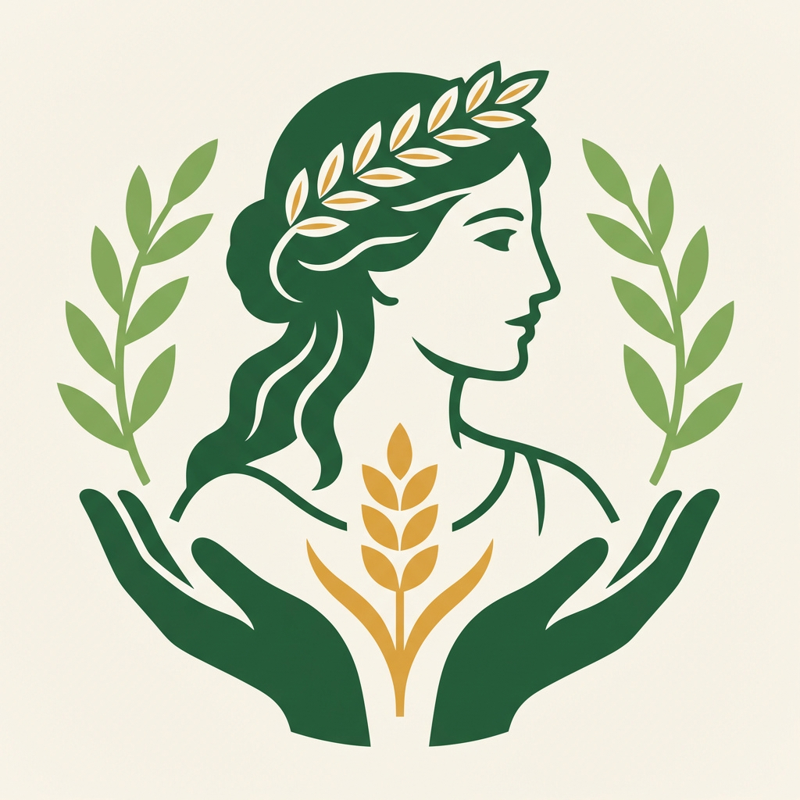
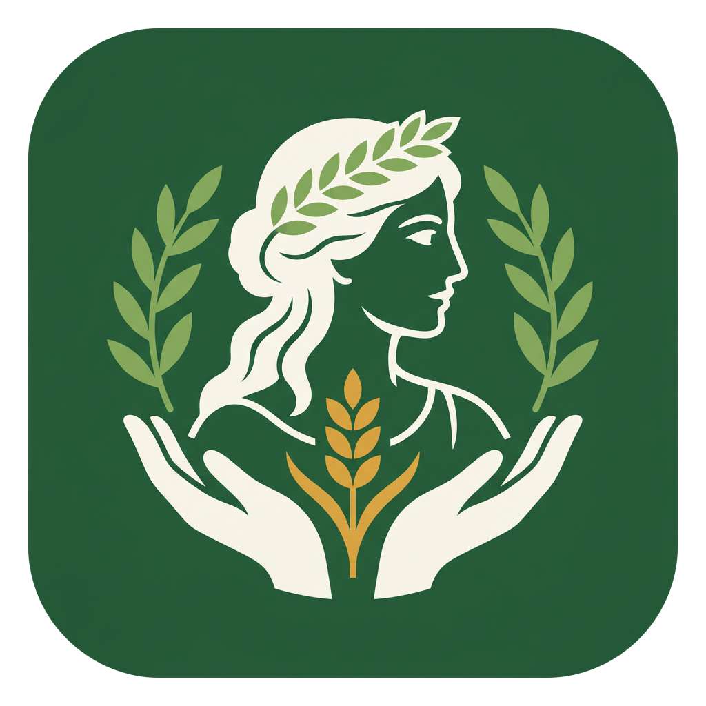

# DEMETRA — Intelligent Food Redistribution Platform

> **Nourishing Communities. Growing Kindness.**

Demetra is a Kotlin & Jetpack Compose Android application designed for Sri Lanka to connect **Food Donors**, **Community Volunteers**, and **Verified Recipients** through explainable **Smart Relay** matching, QR/PIN handover verification, the **Harvest Garden** impact tracker, and **Pip** — an AI guide powered by Firebase AI Logic.

---

## Brand & Mascot Image Assets

All brand and AI assistant image assets are available in [`docs/assets/`](docs/assets/):

| Asset | Preview | Format & Size | Description |
| :--- | :---: | :--- | :--- |
| **Demetra Logo** |  | PNG (`1024×1024`) | Primary Demetra goddess, wheat, and protective hands brand emblem |
| **Demetra App Icon** |  | PNG (`1024×1024`) | Adaptive launcher icon artwork (`#255938` forest backdrop) |
| **Pip AI Help Bot Icon** |  | PNG (`1024×1024`), SVG | Floating circular AI help button badge (`#205B40` ring, `#D9A43C` gold border, `#F7F4E9` cream core) |
| **Pip Mascot Icon** |  | PNG (`1024×1024`), SVG | Standalone transparent vector/PNG illustration of Pip, the botanical green bird with golden wheat crest |

---

## Key Features

### 1. Three Connected User Journeys
- **Donor** (restaurants, hotels, bakeries, individuals): Publish surplus food via a 4-step wizard, attach photos with the zero-permission Android Photo Picker, confirm food hygiene declarations, set a **preset or custom handover pickup window** (day selector + Material 3 `TimePicker` + quick duration chips), and track Smart Relay progress.
- **Volunteer** (community riders & delivery helpers): Explore nearby pickups on an interactive Colombo district map or filterable list, accept tasks, follow pickup/dropoff handover instructions, and verify delivery.
- **Recipient** (community kitchens, shelters, charities): Browse suitable available food by category or dietary preference (`Vegetarian`, `Halal-friendly`, `Vegan`, `Dairy-free`, `Nut-free`), request portions respectfully, and confirm receipt.

### 2. Explainable Smart Relay & Verified Handovers
- **Smart Relay Compatibility**: Breaks down every match with transparent weighted criteria—*Food Category & Demand*, *Distance & Pickup Window*, *Transport Capacity*, and *Dietary Suitability*.
- **QR & 4-Digit PIN Verification**: Ensures accountable food pickup and delivery handovers between donors, volunteers, and recipients.

### 3. Pip — Persistent AI Guide (`Firebase AI Logic`)
- Accessible from any main screen via the floating **Pip** button (`PipAssistantSheet`).
- Streams context-aware answers using **Gemini (`gemini-3.8-flash`)** via **Firebase AI Logic** (`com.google.firebase:firebase-ai`) with **Firebase App Check**.
- Offers screen-specific quick prompts for creating safe listings, understanding Smart Relay matches, food hygiene temperatures, and volunteer coordination.

### 4. Harvest Garden & Community Grove
- *"Every Good Deed Leaves Something Growing"*: Every verified handover blooms a Sri Lankan botanical species (e.g., *Ceylon Lotus*, *Temple Frangipani*, *Golden Marigold*, *Blue Water Lily*) in a 6-slot interactive **Harvest Garden** canvas with selectable themes and a **Community Grove** regional overview.

### 5. Localization, Accessibility & Session Controls
- **Languages**: English (`EN`), Sinhala (`සිංහල`), and Tamil (`தமிழ்`).
- **Accessibility**: Reduced Motion toggle (disables idle bobbing & crossfade/slide transitions), Low Data Mode toggle, and `48dp+` minimum interactive touch targets.
- **Session Management**: Role switching, profile setup, and Log Out support from Settings.

---

## Visual Identity

| Token | Hex | Role |
| :--- | :--- | :--- |
| `ForestGreen` | `#205B40` | Primary actions, navigation, brand anchors |
| `DeepGreen` | `#174B35` | High-contrast botanical accents |
| `SageGreen` | `#79A66A` | Mascot body & natural highlights |
| `HarvestGold` | `#D9A43C` | Highlights, achievements, Pip wheat crest & FAB ring |
| `WarmCream` | `#F7F4E9` | Primary canvas & background surface |
| `DarkText` | `#26372D` | Primary readable body & heading text |

- **Typography**: `Plus Jakarta Sans` (headings/display) & `Inter` (body/labels) bundled locally in `app/src/main/res/font/`.

---

## Tech Stack & Project Structure

- **Language & UI**: Kotlin, Jetpack Compose, Material Design 3, Edge-to-Edge (`WindowInsets.safeDrawing`), responsive layouts (`NavigationBar` on compact widths, `NavigationRail` on `>= 600dp`)
- **Architecture**: MVVM with `StateFlow` (`DemetraViewModel`, `DemetraRepository`, `PreferencesRepository`) and immutable `@Immutable` Compose domain models
- **Navigation**: Navigation Compose (`DemetraApp.kt`)
- **Storage & Images**: Jetpack DataStore Preferences (`settings`), Coil (`AsyncImage` for user-picked food photos)
- **AI Integration**: Firebase AI Logic (`PipAiService.kt`) + Firebase App Check (`AppCheckHelper.kt`)

```text
app/src/main/java/com/example/
├── MainActivity.kt                  # Edge-to-edge entry point & App Check initialization
├── ai/
│   ├── AppCheckHelper.kt            # Firebase App Check setup (Debug / Play Integrity)
│   └── PipAiService.kt              # Streaming Gemini assistant via Firebase AI Logic
├── data/
│   ├── DemetraRepository.kt         # Listings, Smart Relay matching, handovers & Harvest Garden
│   └── PreferencesRepository.kt     # DataStore user preferences (language, reduced motion, low data)
├── i18n/
│   └── DemetraStrings.kt            # EN / SI / TA localized strings
├── model/
│   └── DemetraModels.kt             # @Immutable domain models & enums
├── viewmodel/
│   └── DemetraViewModel.kt          # UI state management, AI chat & donation workflows
└── ui/
    ├── DemetraApp.kt                # NavHost routing, adaptive shell & modals
    ├── components/                  # PipMascot, GardenCanvas, ColomboMapView, QrPinHandoverDialog
    ├── screens/                     # Onboarding, Donor, Volunteer, Recipient, Garden, Pip, Settings
    └── theme/                       # Color.kt, Type.kt, Theme.kt
```

---

## Build & Configuration Notes

- **Android SDK**: `compileSdk = 36`, `minSdk = 24`, `targetSdk = 36`, Java 11
- **Application ID**: `com.aistudio.demetra.kvnxtr`
- **Build Command**:
  ```bash
  gradle assembleDebug
  ```
- **Firebase AI Logic**: Configured via `app/google-services.json` and `app/src/main/res/values/firebase_applet_config.xml` (no manual `GEMINI_API_KEY` required for Firebase AI Logic calls).
- **Prototype Scope**: Pip AI chat streams live responses via Firebase AI Logic, while food listings, Smart Relay scores, Colombo district map coordinates, and QR/PIN handovers operate on in-memory demonstration data.
